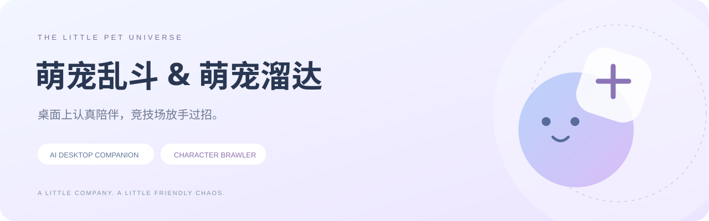
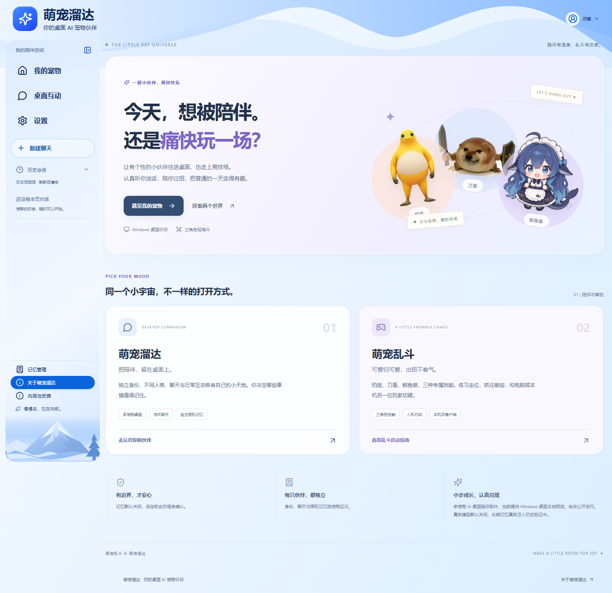
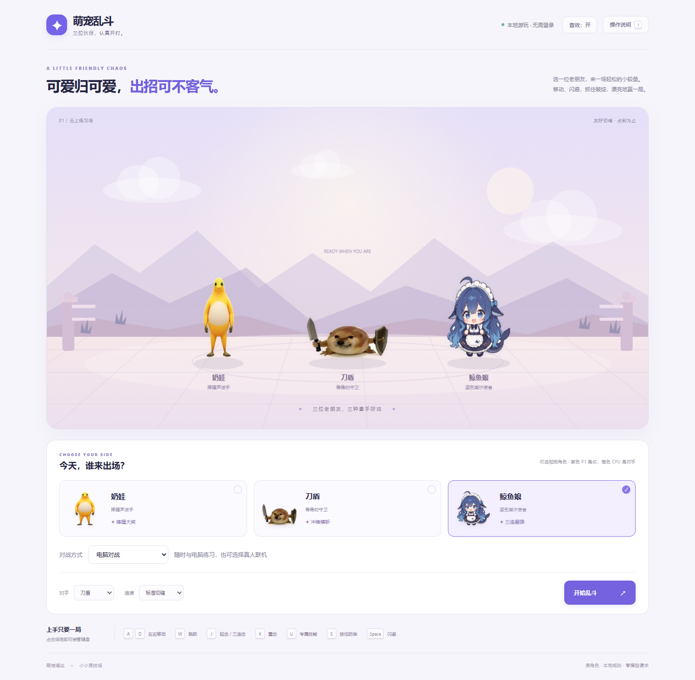

<div align="center">



# 萌宠乱斗 & 萌宠溜达

**桌面上认真陪伴，竞技场放手过招。**

一个把 AI 桌面伙伴与轻格斗游戏放在一起的宠物小宇宙。  
从独立人格、流式聊天，到三角色技能、本机双客户端对战，让角色真正有事可做。

`React 19` · `TypeScript` · `Electron` · `FastAPI` · `LangGraph` · `PostgreSQL` · `Redis` · `DeepSeek`

[萌宠乱斗](#萌宠乱斗--可爱归可爱出招不客气) · [萌宠溜达](#萌宠溜达--把陪伴留在桌面上) · [快速开始](#快速开始) · [验证与边界](#验证与边界)

</div>

## 一群小伙伴，两种快乐

**萌宠乱斗**是一款独立运行的浏览器轻格斗游戏；**萌宠溜达**是 Windows 多宠物 AI 桌面陪伴应用。两者共处一个仓库，保留独立入口和运行边界：玩一局乱斗，无需数据库或模型密钥；开启桌面聊天，则使用完整的身份、会话和隐私控制。



## 萌宠乱斗 · 可爱归可爱，出招不客气

三位角色，三种战斗节奏：**奶娃、刀盾、鲸鱼娘**。走位、跳跃、轻重攻击、正面格挡、闪避和专属技能构成完整的一局；体力、前摇和技能冷却让出招有取舍。

| 角色 | 拿手好戏 |
| --- | --- |
| 奶娃 | 大笑技能，持续多段命中与表情变化 |
| 刀盾 | 冲锋接横斩，把握近身时机 |
| 鲸鱼娘 | 三段星弹，控制距离与节奏 |

- **人机练习**：两档难度、90秒回合、KO与结算、重开与暂停。
- **真人切磋原型**：格斗码与随机匹配，双方移动、伤害和重开同步；已验证范围为本机双浏览器客户端。
- **有反馈的战斗**：角色音效、伤害反馈、生命与体力条，支持静音和触屏按钮。
- **轻量运行**：Node 原生服务与 Canvas，不调用模型、不依赖账号和业务数据库。



[玩法、按键和启动指南 →](games/pet-brawl/README.md)

## 萌宠溜达 · 把陪伴，留在桌面上

宠物拥有自己的实例身份、人格快照、会话与授权记忆空间。桌面窗口负责陪伴，聊天运行时负责把消息、权限与流式回复连起来。

- **Windows 桌面宠物**：透明置顶窗口、拖动、点击聊天、托盘、召唤与收回；已有多宠物开发预览。
- **真实 DeepSeek 桌面聊天**：月芽两轮真实请求成功，SSE增量显示、消息保存、刷新恢复与同会话暗号回忆已验收。
- **按实例分配模型**：用账号UUID与宠物UUID明确选择真实模型，其余实例保持Mock；服务端密钥不进入前端。
- **可控的调用预算**：单次本地后端启动共用请求上限、输入字节上限、输出Token上限和零自动重试。
- **自主授权的记忆基础**：宠物作用域、用户授权、逐条确认、编辑、删除、导出与隐私屏障；真实DeepSeek长期记忆注入尚未验收。
- **可靠的聊天基础**：认证、Cookie会话、CSRF、持久化、幂等、SSE重放与取消路径；真实上游在途取消仍待验证。

> 当前为开发预览，真实模型默认关闭。已经通过的是指定账号、指定月芽实例的有限真实聊天验收，不代表开放服务、全部角色或长期记忆已完成真实验证。

## 快速开始

### 先玩一局：萌宠乱斗

需要 Node.js 22.12 或更高版本。

```powershell
node games/pet-brawl/server.mjs
```

打开终端显示的本机地址，默认 [http://127.0.0.1:43926](http://127.0.0.1:43926)。Windows也可以双击 `games/pet-brawl/start-game.cmd`。

### 桌面伙伴与聊天

需要 Python 3.12–3.14、uv、Node.js 22.12+，以及显式选定的本地隔离 PostgreSQL/Redis。源码不附带数据库、密钥、已安装依赖或正式安装包。

```powershell
cd backend
uv sync --frozen
uv run python -B -m scripts.desktop_chat --check-config
# 回到仓库根目录后
cd ../frontend
npm ci
npm run dev
```

上述配置检查不发送模型请求。完整服务启动还需要数据库目标校验、后端启动、前端代理与Origin配置，不能只靠前端命令获得真实聊天。

- [桌面聊天配置、隔离目标和安全启动](docs/DESKTOP_DEEPSEEK_READINESS_REPORT.md)
- [Windows 桌面预览说明](docs/P6_WINDOWS_START.md)
- [真实 DeepSeek 桌面验收报告](docs/DESKTOP_DEEPSEEK_LIVE_RESUMED_REPORT_20261108.md)

**不要将后端密钥写入 `VITE_*`、源码、截图或浏览器存储。** 本地预算按后端启动计算，重启不能被当成新的付费授权。启动不会自动升级共享数据库。

## 工程结构

```text
MengChong-Universe/
├── games/pet-brawl/    # 独立轻格斗：引擎、AI、联机原型、音效
├── frontend/          # React：宠物、聊天、授权记忆与产品首页
├── desktop/           # Electron：透明窗口、托盘与受限IPC
├── backend/           # FastAPI：认证、SSE、模型、宠物与记忆
└── docs/              # 技术契约、验收报告与展示资源
```

聊天从前端经SSE进入FastAPI运行时，在派发前经过所有权、人格与隐私状态、额度检查，再由SDK访问上游。记忆与模型模式按宠物实例绑定；游戏保持独立，不绕过聊天权限，也不消耗模型额度。

## 验证与边界

| 验证项目 | 已有证据 |
| --- | --- |
| 真实桌面DeepSeek | 2/2次成功；同会话上下文、SSE、显示与刷新恢复通过 |
| Token用量 | 输入295、输出14；供应商实际费用尚未核账 |
| 本轮后端离线专项 | 146项通过：配置、预算、SDK、宠物运行时、启动器与授权保护 |
| 游戏历史验收 | 119项离线；本机双客户端14组与人机完整13组，详见专项报告 |
| 发布整理的新增检查 | 见[本次验证记录](docs/GITHUB_PRESENTATION_20261108.md) |

历史结果与本轮结果分别记录，不将重复测试相加作为覆盖率。当前上传账号未授予工作流权限，自动检查配置保存在 `docs/ci/weibiye-ci.yml.template`，尚未启用远程Actions。

**仍在推进**：真实长期记忆注入、真实上游取消、互联网对战、签名安装器、自动更新与持续性能验证。QQ保留实验性离线接入基础，尚未完成真实接入。本仓库不提供线上服务承诺。

## 素材与使用

角色图像及部分音频来自用户素材，原始出处记录在 `games/pet-brawl/assets/` 的来源文件中；原有记录将其使用范围标为本地，公开再分发和商业权利尚未确认。当前仓库先以私有方式保存与展示，不追加未经确认的开源或素材授权。

---

**给日常一点陪伴，给快乐一点胜负欲。**  
萌宠乱斗 & 萌宠溜达 · A little company. A little friendly chaos.
