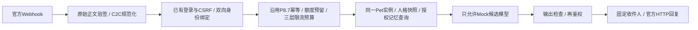

# P8.7.1 QQ 官方协议适配器与真实接入准备

日期：2026-11-03。阶段状态：**P871_OFFICIAL_PROTOCOL_OFFLINE_VERIFIED**。

本轮实现官方协议和显式启用的本地隔离沙箱，完成离线验证。**没有读取真实 AppSecret，没有连接QQ、取真实Access Token、发送真实QQ消息、调用DeepSeek或部署公开服务。** 创建了新的SQLite测试目标；未连接或修改共享PostgreSQL/Redis。真实QQ验签、回调配置、单聊权限和收发体验仍未验证。

## 1. 官方文档核查

| 项目 | 核查结果与采用方式 |
| --- | --- |
| 接收方式 | 官方仍描述Webhook和WebSocket；本轮实现Webhook，未实现WebSocket连接、心跳或重连。实际开放范围以本机器人控制台为准。[事件订阅](https://bot.q.qq.com/wiki/develop/api-v2/dev-prepare/interface-framework/event-emit.html) |
| Webhook | HTTPS、指定端口、op=13地址验证、op=12回调确认；业务入站必须验签。只订阅C2C单聊，不处理群聊、附件和转发引用 |
| 签名 | 根据Bot Secret重复/截取生成32字节种子，Ed25519校验`timestamp + 原始HTTP正文`。使用可信密码库，不自行实现曲线算法。[官方签名](https://bot.q.qq.com/wiki/develop/api-v2/dev-prepare/interface-framework/sign.html)、[Cryptography接口](https://cryptography.io/en/latest/hazmat/primitives/asymmetric/ed25519/) |
| 单聊身份 | 使用`author.user_openid`，按AppID分域，不按昵称、QQ号码、数组索引或union字段认领。[C2C事件](https://bot.q.qq.com/wiki/develop/api-v2/autogen/event/c2c_message_create.html) |
| 消息标识 | 保留真实`ROBOT1.0_…`消息ID及`message_scene.ext`中`msg_idx=REFIDX_…==`，兼容旧文本事件的msg_seq；拒绝歧义索引 |
| 访问凭证 | 按现网文档使用`https://api.bot.qq.com/app/getAppAccessToken`，服务端AppID/AppSecret换取Access Token；检查HTTP状态和响应体code，有效期最多7200秒，接近过期时单飞刷新。[访问凭证](https://bot.q.qq.com/wiki/develop/api-v2/dev-prepare/access-token.html) |
| 回复 | 固定官方HTTPS源的`/v2/users/{user_openid}/messages`，仅纯文本、绑定到原入站msg_id、固定msg_seq=1，不主动推送。不因重复错误递增序号绕过去重。[单聊发送](https://bot.q.qq.com/wiki/develop/api-v2/autogen/api/v2_users_user_openid_messages.post.html) |

当前单聊文档的被动回复时限仍有60分钟与参数说明5分钟的差异；本地采用更短120秒期限及一次完整回复，实际时限、审核状态和限额需真实沙箱验证。创建了机器人并不等于已获公开服务、全部消息权限或商业托管许可。[API调用指南](https://bot.q.qq.com/wiki/develop/api-v2/dev-prepare/api-call-guide.html)

官方样例中的op=13回调不一定附带业务签名。因此地址验证独立处理：默认关闭，仅显式开启后5分钟内有效，每分钟最多5次，要求正确AppID、新鲜时间及短小不透明plain_token；拒绝JSON/任意长串作为签名材料，避免变成可以伪造业务事件的签名接口。该兼容路径尚待真实控制台确认。

## 2. 实现与复用边界



- 抽出P8.7内部执行引擎；`MockPetChannel`继续保留原来的Mock类型保护，不允许用官方Adapter替换后偷偷联网。新`OfficialSandboxPetChannel`必须显式启用，且仍拒绝真实模型对象。
- 绑定接口复用现有平台Cookie、Origin、CSRF和命令频控，owner来自服务端认证，不接受正文自报owner。宠物必须属于该owner。QQ一端使用验签后的AppID/OpenID，再用一次性确认码回到平台账号确认。支持查询自己的绑定和撤销。
- 使用既有八角色领养接口、Pet实例UUID及`ExistingPetContextReader`。人格和记忆读自原有模型/授权规则，不复制一套QQ私人记忆。跨通道读取记忆默认关闭，必须显式授权，并在发送前核验绑定、人格和隐私版本。
- 普通入站在元数据事务预留后即ACK，后台任务归当前服务所有；绑定确认发送也不阻塞ACK等待Token网络。取消/关闭时收尾所有任务和客户端。
- Token取得过程会让出执行；消息POST之前再次核验权限、期限和暂停状态。已知未发送才允许一次显式重投同一候选；超时、重复码、202审核状态、5xx和回执不明均不自动重发、不重新生成。
- 官方Adapter自身还有有界发送缓存，重复/并发发送相同候选不会重复POST，不同候选不能覆盖同一入站回复。
- HTTP客户端不使用环境代理、不跟随重定向、保持TLS校验，固定官方源。依赖日志按本次QQ调用上下文屏蔽，异常只保留固定类别，不记录OpenID URL、Header、请求/回复正文或原始错误。

**DeepSeek与生产额度边界：** 本轮没有把QQ候选接入真实DeepSeek Provider或ChatRunner；官方沙箱硬性只允许Mock。P8.3的生产`reserve/mark-dispatch/settle/release`和网页/Electron额度账本仍保持原路径，不能把当前P8.7模拟账本当作跨通道生产额度已经打通。真实模型下一阶段必须在同一生产额度域接入、验证多进程事务/预算，再另行授权费用；不能通过开放原型基类或更换环境变量绕过。

## 3. 隔离沙箱与默认保护

新目标已生成：

```text
D:\AIProjects\WeiBiYe-worktrees\consumer-desktop-pivot\.verification\p871\sandbox-e7b554e3-47a8-4a6a-b66f-d9b3c628385b\target.json
```

目标是独立、初始为空的SQLite测试库，实际执行既有迁移到`0006`并写入专属运行身份。启动前检查路径、非共享声明、运行UUID、数据库内身份和迁移版本；拒绝移植/伪造目标、符号链接/目录联接、共享URL或其他数据库。迁移使用显式注入的目标连接。没有复制现有真实账号、宠物、聊天或记忆。

沙箱使用独立Cookie名称，避免同一电脑上不同端口的登录覆盖原产品Cookie。认证和频控使用本地内存，不连接共享Redis；已有全应用`/health/ready`仍会要求Redis，不修改或伪造它。专用`/api/v1/qq/sandbox-ready`只核查这套隔离QQ测试组合，不代表全应用或真实QQ就绪。

元数据侧库沿用P8.7命名空间校验，并用进程凭证按运行UUID派生独立HMAC域密钥，原始凭证不写库。同一目标重启恢复账号、宠物和模拟账本；换AppSecret导致派生域不匹配时拒绝自动打开旧账本，不自动清空。需要轮换时另行安排隔离迁移。

每个已认证且拥有宠物的测试账号只初始化一次5个**总模拟请求名额**，不是生产免费额度或每日重领；夜间保护和每日上限继续有效。默认保护时段为北京时间22:00至08:00，此时正常聊天会被拒绝，不能调机器时间或换账号绕过验收。固定回复预算仍为示例价格，Mock使用字节计数，不是DeepSeek Tokenizer；实际供应商费用为null。

正文/候选仅存在处理内存，不写QQ账本或平台聊天历史。故障重启将未完成元数据任务标为abandoned，不恢复正文、不自动重新生成；这有意选择“可能丢失一次回复”而不冒险重复发送。生产可靠outbox、加密短期正文与分布式租约尚未实现，不能宣称生产exactly-once。

## 4. 已完成的离线验证

| 范围 | 通过 | 失败/跳过 |
| --- | ---: | --- |
| P8.7.1协议、HTTP、FastAPI和隔离沙箱 | 73 | 0 / 0 |
| 原P8.7通道、容量、记忆回归 | 70 | 0 / 0 |
| 既有宠物聊天、SSE、额度和隐私回归 | 42 | 0 / 0 |
| 前端单元 | 66 | 0 / 0 |
| Electron桌面单元 | 233 | 0 / 0 |
| Ruff / 格式 | 18个Python文件通过 | 0 |

合计484个不同用例通过。协议/HTTP测试使用独立构造的合成签名与`httpx.MockTransport`，禁止网络连接；FastAPI测试使用真实既有认证、领养、人格、记忆授权接口与临时SQLite。不是QQ真实消息或Windows视觉验收。P8.3 PostgreSQL专项、本轮未改动的真实DeepSeek/上游取消及真实QQ收发没有转为已验证。

覆盖：原始签名材料、过期/篡改/跨bot事件、重复Header/JSON键、真实形状的ID和索引、禁群聊/附件/引用、Token HTTP200错误、刷新单飞、401/403/429/5xx/审核/重复码、超时不重试、发送目标锁定、候选冲突、晚到暂停/撤销、快速ACK、Cookie/CSRF、两只同名哈吉米及其他账号的刀盾隔离、原有八角色目录、重复额度初始化拒绝、实例/额度重启恢复、启动失败及退出清理。

最初新增测试存在SQLite连接未显式关闭和一条过长代码行，已修复并保持warnings-as-errors与原断言，最终全量通过；保留初始失败诊断，不以跳过掩盖。

证据：

- `.verification/p871/research-f820edf2-6798-41ac-87fe-1c5290b434c8`：官方URL、原文、时间与哈希。
- `.verification/p871/validation-8f0d3496-bcf0-4804-be48-f02eb538876d`：测试日志/XML、依赖变化、源文件清单、保护核验及提交记录。
- 上述`sandbox-e7b554e3-…`是可变测试目标，不属于旧阶段的历史验收证据；未启动真实服务或写入真实消息。

## 5. 现在可执行的离线本地步骤

本轮已安装官方PyPI的`cryptography==50.0.2`到项目虚拟环境，增加`qq`可选依赖及锁文件；既有依赖版本未升级。默认应用不导入QQ实现、不读取QQ凭证、不挂载QQ路由。

```powershell
Set-Location 'D:\AIProjects\WeiBiYe-worktrees\consumer-desktop-pivot\backend'
.\.venv\Scripts\python.exe -B -m scripts.p871_qq_offline
```

该检查不读取任何进程凭证。新机器如缺依赖，先按锁文件安装可选组：`uv sync --locked --extra qq --inexact`（保留额外已安装包），再运行检查。

如确需另一个全新空测试目标，可以单独执行以下离线命令；不能手动编辑旧目标身份字段，也不会重置现有目标：

```powershell
.\.venv\Scripts\python.exe -B -m scripts.p871_qq_sandbox --prepare-local
```

## 6. 下一次真实QQ沙箱的前置条件

1. 用户另行明确允许真实QQ连接和消息次数；仍禁止DeepSeek。控制台确认本bot允许C2C、测试成员和Webhook，测试账号已按官方流程添加机器人。
2. 批准一个可达的HTTPS入口，仅转发`POST /api/v1/qq/callback`到本机；保留原始正文和三个官方Header。不要公开转发`/docs`、认证、宠物、绑定管理或整个后端。支持端口以官方文档为准。本轮未安装/启动隧道、代理或改防火墙。
3. 先确认38711端口空闲、隔离目标身份仍正确；AppID/AppSecret仅由用户在本地输入，不发送给Codex，不填进前端，不写.env、文件或命令参数。
4. 准备该空沙箱自己的测试平台账号和领养实例；原共享库/当前桌面账号不会自动迁入。首轮关闭跨通道长期记忆权限，后续再明确授权专项。

以下命令**仅供下一次获准后手动执行，本轮未运行**。它可能取真实QQ Token并回复QQ，但模型始终是Mock：

```powershell
Set-Location 'D:\AIProjects\WeiBiYe-worktrees\consumer-desktop-pivot\backend'
$qqTarget = 'D:\AIProjects\WeiBiYe-worktrees\consumer-desktop-pivot\.verification\p871\sandbox-e7b554e3-47a8-4a6a-b66f-d9b3c628385b\target.json'
$env:WEIBIYE_QQ_MODE = 'official-webhook'
$env:WEIBIYE_QQ_APP_ID = Read-Host '输入官方测试机器人 AppID'
$qqSecret = Read-Host '输入机器人 AppSecret（不是个人QQ密码）' -AsSecureString
try {
  $env:WEIBIYE_QQ_APP_SECRET = [Net.NetworkCredential]::new('', $qqSecret).Password
  $env:WEIBIYE_QQ_ALLOW_NETWORK = '1'
  $env:WEIBIYE_QQ_ALLOW_SEND = '1'
  .\.venv\Scripts\python.exe -B -m scripts.p871_qq_sandbox `
    --serve --target $qqTarget --port 38711 `
    --confirm-qq-network --confirm-qq-send --enable-callback-validation
} finally {
  Remove-Item Env:WEIBIYE_QQ_APP_SECRET, Env:WEIBIYE_QQ_APP_ID, Env:WEIBIYE_QQ_MODE, Env:WEIBIYE_QQ_ALLOW_NETWORK, Env:WEIBIYE_QQ_ALLOW_SEND -ErrorAction SilentlyContinue
  $qqSecret.Dispose()
  Remove-Variable qqSecret -ErrorAction SilentlyContinue
}
```

启动程序先验证隔离目标和双确认参数，再显式读取QQ环境变量；随后从子进程环境移除继承的模型/QQ配置值，保留已加载的后端凭证对象。该启动流程不加载模型Key，真实模型保持禁用。父PowerShell环境在finally清理，未修改用户永久环境变量。关闭用Ctrl+C；关闭后确认本次端口与任务退出。

地址验证只在启动后的5分钟内允许。超时停止本次验收，由操作人重新决定是否打开新的验证窗口，不能关闭签名校验。

## 7. 获准后的绑定与首条消息操作

所有管理请求仅访问`http://127.0.0.1:38711`，使用独立Cookie会话，Origin为该本地地址。每次命令先GET`/api/v1/auth/csrf`取得`csrf_token`，带`X-CSRF-Token`；领养还需唯一`Idempotency-Key`。

| 次序 | 操作 |
| --- | --- |
| 1 | GET`/api/v1/qq/sandbox-ready`应返回隔离Mock模型就绪。它不表示QQ已连接，不替代原全应用Redis就绪检查 |
| 2 | 用既有`/api/v1/auth/register`、`/login`创建并登录**新测试平台账号**；不要使用个人QQ密码。可在仅本机的`/docs`查看接口 |
| 3 | GET`/api/v1/pet-instances/species`查看八角色；POST`/api/v1/pet-instances`，如`{"species_id":"hajimi","name":"测试哈吉米"}`，保存返回的`pet_instance_id` |
| 4 | POST`/api/v1/qq/bindings/challenges`，正文`{"pet_instance_id":"返回的UUID"}`，取一次性token |
| 5 | 按官方允许方式在测试QQ单聊向bot发送`/bind 一次性token`；后端只向该已验证QQ身份返回确认码。这个token不是AppSecret或Access Token |
| 6 | POST`/api/v1/qq/bindings/confirm`，正文含原token、QQ收到的confirmation和`allow_memory:false`。仅同一已登录平台账号能确认 |
| 7 | QQ发送一次“你好”。预期仅一条`【AI宠物·测试Mock】`回复；不要把它当作真实DeepSeek成功。首轮最少2条外发：绑定控制确认1条、模型Mock候选1条 |
| 8 | GET`/api/v1/qq/bindings`查看本账号绑定；POST`/bindings/revoke`携带返回的subject_hmac撤销。收件人始终来自入站身份，模型不能选收件人 |

如验签、权限、绑定、预算、内容审核或发送回执失败，停止后续发送并保存脱敏状态；不修改序号重试、不绕过身份或额度。默认预算耗尽/夜间保护等拒绝会ACK但不额外向QQ发送未预算的错误通知；完整用户错误提示UI尚未开发。

## 8. 修改范围、保护和未验证事项

- 新增`backend/app/modules/qq_p871/`：`__init__.py`、`config.py`、`protocol.py`、`http.py`、`adapter.py`、`runtime.py`、`routes.py`、`sandbox.py`。
- 最小修改P8.7的`contracts.py`、`runtime.py`、`store.py`，共享执行机制、元数据通道标识和账号自身绑定查询；保留Mock构造保护。
- 新增`scripts/p871_qq_offline.py`、`scripts/p871_qq_sandbox.py`。
- 新增`tests/qq_p871_helpers.py`及`test_p871_protocol.py`、`test_p871_http.py`、`test_p871_integration.py`、`test_p871_sandbox.py`。
- 修改`backend/pyproject.toml`、`backend/uv.lock`，新增本报告。共21个本轮文件。

未修改现有FastAPI全局配置/入口、DeepSeek Provider、数据库迁移、React、Electron、宠物素材或历史未提交模块；现有桌面演示不停止、不重载。工作区基线为分支`codex/consumer-desktop-pivot`、HEAD`93cd622d7557f879035492a16ac86d933afe11a4`、191处历史未提交改动。只提交上述本轮文件；历史未跟踪宠物/额度模块继续保留，因此这些本地集成依赖当前工作树，不能声称单独检出本次提交就可发行。

未验证：真实QQ控制台op=13、签名/Token及消息回执、官方审核/限额、实际QQ重连投递、真实负载、多进程一致性；真实DeepSeek及统一生产额度；外部HTTPS入口；生产密钥库、完整内容审核、未成年人身份验证和公开运营许可。当前正则安全基线不等于完整审核系统。原P8.1真实上游取消依然未验证。仅本轮本地准备可收尾，不能公开上线或宣布QQ真实接入通过。

本地代码提交：`db90dc5cc58600582639f4e6ac95fc3f0b45f06e`（20个文件）；本报告单独作本地文档提交，完整提交记录在本轮validation目录的`commits.json`。提交前核验191处历史未提交状态不变，676个原有源文件中仅5个原本干净的本轮基础文件发生预期修改，18,719份历史证据哈希无变化；最终结果见`final-preservation.json`。38711没有监听、本轮无残留服务，已有桌面演示继续保留。不推送、不部署、不关机。
