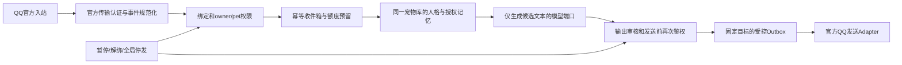

# P8.7 QQ 安全架构与本地实验边界

本轮只提供隔离Mock，未接入QQ和真实模型，未挂载到`app.main`。以下明确区分本地实现、现有可复用能力与真实服务上线前必须补齐的部分。

## 1. 信任边界

真实QQ的网络认证和发送端尚未实现。本地用`MockQQAdapter.verify/reply`替代两端；实验签名仅用于验证消息未经本地模拟器篡改，**不声称实现QQ Ed25519验签**。QQ/OpenClaw提供的任意文件、系统命令、工具执行、升级、主动群发能力均不引入。

AI端口只能返回文本候选和受限模拟用量，不能返回收件人、机器人AppID、宠物ID、工具调用或发送指令。发送目标从已认证入站消息和当前绑定生成，模型没有目标选择权。

## 2. 身份和绑定

内部键分别为：`owner_user_id`、`pet_instance_id`、`bot_app_id`、`scene`、`subject_hmac`、`binding_version`、`channel_consent_version`。species/name仅用于外观和展示。OpenID按bot分域，不把群成员openid、单聊openid、union字段或昵称当作可互换身份。

其中最后一项是正式版设计：原型将通道记忆同意保存在绑定记录的`memory_allowed`中，任何重新绑定均递增`binding_version`，另外核验现有记忆的`privacy_epoch`；尚未引入独立生产授权表。原型方法的owner参数由实验初始化的可信调用方传入，没有对外HTTP接口，也不能把这当作已完成真实QQ登录。

已登录用户的实验绑定采用双向证明：

1. 后端根据已认证平台账号核验宠物归属，创建一次性随机口令（短时有效、只保存摘要、限制尝试次数）。绑定请求由平台会话创建，入站消息不能自选owner。
2. 用户从对应QQ单聊发送口令；服务端从经过验证的事件取得bot和发送者身份，不能接受正文自报QQ号码。
3. 返回另一条确认码，只向该已验证发送者回复；用户在原平台认证会话填写确认码，显式确认宠物及权限后才生效。
4. 任一码跨账号、跨bot、过期、猜测失败过多或重复使用均拒绝；同bot同QQ身份已经被其他owner绑定时拒绝冒领。
5. 切换宠物必须由已认证账户操作并再次核验归属；绑定版本递增，旧任务不能借此发给新宠物/账号。

这只是本地已登录账号的安全实验。真实QQ基础入门应避免未经允许强制依赖外部应用，原生QQ建号、外部账号关联和官方授权形式见可行性报告的待确认项。

模式B的bot所有权必须另外取得官方管理授权证明。仅提交AppID、截图、昵称或收到某bot消息均不能证明拥有该bot。原型只接受实验初始化的bot记录，不接收真实机器人凭证。

## 3. 凭证与密钥

- DeepSeek Key始终留在后端，客户端和QQ消息不可读取。原型不创建真实模型客户端，不读取环境里的模型密钥。
- 本轮不收集或持久化AppSecret、Access Token、个人QQ密码，因此不把“未存凭证”描述为“已实现生产密钥库”。
- 模式B上线前必须实现KMS/专用密钥库的信封加密：每租户/凭证独立数据密钥，AES-GCM随机nonce，AAD绑定owner、AppID、用途及版本；主密钥不放数据库、不进入仓库/浏览器。
- 密文读权限只给相应连接worker；管理员也不提供显示明文接口。轮换、撤销、删除和访问审计独立处理，不能把改用新Key当作绕过额度的方法。
- QQ访问Token按AppID缓存和单飞刷新、提前抖动刷新；校验响应体错误码，凭证获取失败即停发。真实行为需沙箱验证。[官方凭证文档](https://bot.q.qq.com/wiki/develop/api-v2/dev-prepare/access-token.html)

## 4. 幂等、失败和重试

持久实验收件箱使用bot + 场景 + 发送者作用域 + msg_id + msg_idx的HMAC键；消息正文只用于带密钥的指纹冲突检查，不落库。QQ事件ID变化但消息ID/索引相同仍能去重。相同键不同内容拒绝，不覆盖先前任务。

状态流：`admitted → generating → sending → sent`；失败进入明确的终态：`blocked`、`model_timeout`、`model_failed`、`delivery_failed`、`delivery_unknown`、`abandoned`。每条消息最多一次模型尝试。重启时不恢复正文或自动重跑在途模型，未完成任务按未知/保守消耗处理。

发送只用固定回复序号1。已发送的重复入站不再生成/发送。明确确认“没有发出”的失败最多允许一次显式本地重投递，复用同一候选/目标/消息序号并重新核验授权，不重新调用模型；网络超时或成功回执不明一律`delivery_unknown`，不自动重发、不递增序号假装新回复。不承诺跨QQ网络的严格exactly-once。

QQ页包含重复投递、去重、正文审核以及异步响应等语义；真实Adapter必须同时判定响应体、消息ID和审核状态，HTTP2xx不是充分成功条件。[官方单聊接口](https://bot.q.qq.com/wiki/develop/api-v2/autogen/api/v2_users_user_openid_messages.post.html)

## 5. 额度与成本保护

账号额度、bot/平台每日预算及三层频控在同一实验数据库事务内检查和预留。重复消息不重复预留；同账号限制在途请求，平台限制待处理总数和模型并发。账号免费额度只初始化一次，解绑、换宠物、换bot不会重置额度。

已分发模型的超时/未知费用不直接全额返还，保守占用预留上限；确认模型未调用才释放。已生成但QQ发送失败不再免费生成另一次。真实供应商账单未知为null，不能当作0。实验用量、内部免费额度和模拟USD成本分别记账，不是真实货币余额或支付。

现有P8.3预算/授权服务未来应成为跨网页、Electron和QQ的统一额度域；本轮实验账本不向现有账户发放额外额度。多账号反刷不是“唯一账号约束”就能解决：正式版需要有效邀请/验证、bot身份绑定限制、全局硬预算、异常检测和申诉；跨不同AppID的同一真人识别尚未确认，不采集设备指纹来假装解决。

## 6. 人格、记忆与删除

ContextReader读取现有`Pet`、`PetMemoryPreferences`和`eligible_candidates`，复用既有授权与来源规则，不新建另一套QQ私人记忆。QQ绑定还需单独授权读取跨通道记忆，默认关闭。人格、记忆读取及发送前比较owner、pet、人格/隐私版本与授权指纹；撤销/更名/删除引起变化时拒绝发送旧候选。

不把QQ正文自动喂给网页会话历史，不自动产生长期记忆；现有ChatService默认保存正文，不能直接无条件复用其持久化入口。原型没有向原宠物库写入数据的路径。共同事件及RAG不在本轮QQ原型范围内。

真实服务需要把权限检查和发送“开始”的线性化点设计为可审计栅栏。暂停/解绑完成后不再启动新发送；已进入网络的消息无法承诺收回。原型验证发送前拒绝，不能将此宣传为已验证真实QQ在途中断。

## 7. 内容与反诈骗

生产前置限制：只处理授权C2C纯文本；限制体积/时间/新鲜度；拒绝机器人互回、群聊、附件、引用递归、任意工具和模型指定目标；限制账号、bot、平台频率和并发。正文中的owner/pet/收件人声明没有授权作用。原型已验证模拟C2C固定字段、期限、身份和三层准入控制；真实事件作者类型、附件和引用的解析/拒绝仍须在官方Adapter实现并验证。

输出后置限制：候选必须是纯文本、长度受限；拒绝链接、索取验证码/密码、转账收款、批量@、冒充真人/官方客服及系统命令。先做Unicode规范化，再执行本地保守规则。模型提示不是安全栅栏，运行身份没有文件/命令/群发工具。

**规则只是Mock原型的确定性基线，不是通用内容审核系统**；混淆语、语义诈骗、误杀率和正式未成年人内容防护尚未实测。正式QQ接入前必须补齐独立审核服务、人工举报/投诉与处置机制，审核不可用时停发；严禁把“正则测试通过”当作公共服务安全认证。

## 8. 未成年人和数据最小化

未知年龄按保护模式处理：更小每日上限、夜间限制、禁成人/诱导付费/依赖性关系/索取秘密；不通过负面情绪强迫付费，不收集生日/身份证来做实验。真实年龄/监护授权和投诉机制需另行确认，不能靠一个勾选框声称完成。

实验SQLite仅保存绑定摘要、幂等状态、Token/模拟成本、额度和枚举状态；不存QQ原文、人格/记忆正文、候选回复、凭证或原始异常。原始QQ标识和候选只在本次处理内存中存在，关闭清除；重启不重建正文。审计不记录原文、普通哈希或未经筛选的报错。

正式建议事件去重/最小审计7天、聚合用量30天（需最终隐私告知与平台审核），瞬时待发正文加密且分钟级过期。用户可停止、撤销和删除QQ绑定/通道数据，不误删既有桌面宠物/私人记忆。终止服务后的QQ数据处理需满足平台规范；留存政策和备份删除流程未上线验证。[运营规范](https://bot.q.qq.com/wiki/business/)

## 9. 当前上线门禁

QQ真实连接、AppSecret采集、公开Webhook、付费模型、公众开放、支付均保持未实现/关闭。本轮不改现有FastAPI生产路由、React导航、Electron窗口、数据库迁移或部署配置。正式实现需PostgreSQL原子inbox/outbox和分布式租约、Redis全局速率/并发控制、密钥库、真实验签、审核与官方权限确认，不能把单机Mock数据库当分布式生产实现。
