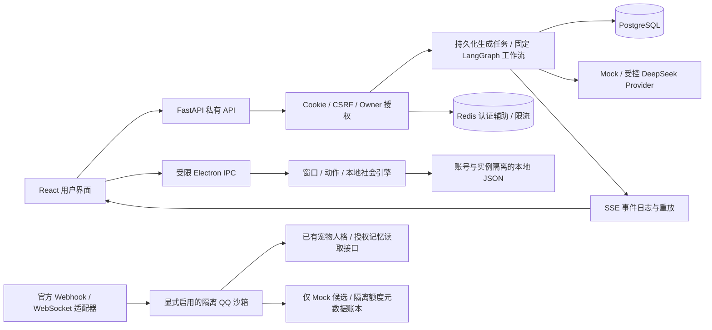

# 萌宠溜达全量技术与交付审计

审计日期：2026-11-04（北京时间）。对象：`D:\AIProjects\WeiBiYe-worktrees\consumer-desktop-pivot`。分支：`codex/consumer-desktop-pivot`；审计基准 HEAD：`eafe8bd95e7d6267e31f8d9ca5d0b7bfed914183`。

## 1. 结论与证据边界

项目已是**有本机 Windows 实测的桌面宠物开发 MVP，以及有离线协议测试的 QQ 接入原型**。它尚不是普通用户可以独立使用的完整在线服务，也没有形成可收费产品闭环。不能把阶段编号换算成整体完成百分比：本机功能、跨设备交付、真实模型记忆、QQ 平台许可和商业验证的成熟度差异很大。

本次只读检查源码、Git、锁文件、原始 JSON/JUnit/日志、截图及阶段报告；不运行应用、测试、构建、数据库查询、迁移或模型/QQ 网络请求，不读取环境变量中的凭证。允许的写入仅为本次三份报告。报告中的“通过”均指对应历史运行，不是本次重新执行。只读浏览了官方公开文档，未访问机器人控制台。

证据分级：

- **代码事实**：当前工作树存在可追踪的实现和调用路径。
- **历史实测**：存在具体运行目录和原始结果，注明设备、模型及版本边界。
- **离线/Mock**：真实业务代码配合合成模型、假网关或隔离数据库，不等于真实模型、QQ 或公开部署。
- **推断/待验证**：容量计算、潜在风险和下一步判断，不当成已经发生的故障或商业事实。

抽查了 39 份历史 JUnit，包含 6 份有失败/错误的中间运行；它们保留在历史中，不能全部相加为“当前失败”，也不能因后来成功而删除。最新 P8.7.2 原始 XML 为 199 个协议/既有 QQ 用例和 42 个相关后端用例，均零失败/跳过；客户端日志分别为前端 66、桌面 233 通过。合计 **540 个不同的选定用例**，不是当前全项目一次全量测试或覆盖率。P8.7.2 的 21 个最终源码清单条目与当前文件 SHA-256 全部匹配。

## 2. Git 完整性与可复现性

审计开始时有 **191 条历史未提交路径**，索引为空。普通 `git status --porcelain` 折叠未跟踪目录时只有 158 条；使用 `-uall` 才得到 191，不是有 33 个成果丢失。

| 实际路径 | 已跟踪文件 | 未跟踪文件 | 影响 |
| --- | ---: | ---: | --- |
| `backend/app/modules/pets` | 0 | 13 | 宠物、会话、记忆基础实现不在 HEAD |
| `backend/app/modules/beta_quota` | 0 | 8 | 生产内测额度及统计基础不在 HEAD |
| `backend/migrations/versions` | 5 | 1 | `0006_pet_scope.py` 未跟踪 |
| `frontend/src/features/pets` | 0 | 4 | 部分宠物功能前置代码未跟踪 |
| `desktop/src` | 27 | 3 | 仍有未提交桌面前置模块 |

例如，已提交的 `backend/app/modules/pet_instances/router.py` 导入未跟踪的 `app.modules.pets.service`；已提交的 QQ `context.py` 导入未跟踪的宠物模型/记忆策略。仅检出当前 Git 提交无法获得这些依赖。这是静态依赖证据，**本次未新建或执行干净克隆**。

本机验收是真实的，但依赖完整工作树。后续应先由成果所有者整理前置代码，再验证隔离干净检出、锁文件安装、迁移与构建；不能随意把全部历史 WIP 混入某个新功能提交。本次不整理、不暂存、不提交它们。

本轮保护基线包含 704 个 Git 可见非环境配置文件、18,834 个历史证据文件；不读取 `.env*` 内容。已知正在使用的旧演示目录 `p86/p862-demo-a80ebf35-3a29-4a30-ab7e-9577615c5bb9` 明确排除于静态历史哈希，避免把用户实时使用写入误认为篡改。收尾保护核验见文末。

## 3. 技术架构

### 3.1 模块与通信

图中 QQ 沙箱不是生产聊天服务的第二条已完成真实模型入口。本机社会 JSON 也不是 PostgreSQL 长期私人记忆的副本。

### 3.2 前端

`frontend/package.json`：React 19.2、TypeScript 5.9、Vite 7、React Router 7、TanStack Query 5、Axios、Tailwind CSS 4、Lucide 图标；Node 要求不低于 22.12。版本来自项目声明/锁文件，不是对这些版本安全或长期支持的推荐。

`src/App.tsx`、`components/layout.tsx` 组织登录、宠物、聊天、记忆、设置等页面；`features/chat/PrivateChatProvider.tsx` 管理会话状态；`private-stream.ts` 使用带凭证的 fetch、增量解码和 `Last-Event-ID` 恢复。没有让前端持有模型 API Key。P8.6.2/3 的蓝白主题与实例卡片存在，P8.6.3 将社会管理入口移入设置，没有删除数据能力。

### 3.3 后端

Python 3.12–3.14 范围、FastAPI/Uvicorn、SQLAlchemy 2 异步、psycopg 3、Alembic、Pydantic Settings、Redis、LangGraph、OpenAI 兼容 SDK、Argon2。QQ 为可选依赖组：cryptography、httpx、websockets。入口 `backend/app/main.py:create_app`，模块化单体而非微服务。

主要模块：`auth/users`、`pets/pet_instances`、`companion`、`memory`、`beta_quota`、`qq_p87/qq_p871/qq_p872`。原社区、求职、审核和钱包模型/路由仍在后端；消费者 UI 去掉入口不代表这些模块已从 API 中删除（`app/api/router.py`）。需要在未来部署清单里逐个审查暴露范围，而非本次无关重构。

### 3.4 Electron

Electron 45.2.1、CommonJS 主进程、受限 preload；React 管理/聊天视图与轻量宠物 renderer 分离。主进程 `manager.cjs` 管理按宠物实例 UUID 索引的记录、窗口、聊天、权限、位置、动作与社交状态。

- 每个桌宠拥有独立窗口/渲染状态；聊天窗口按实例复用。安全隔离和内存成本同时存在，不能把它描述为一个渲染器显示五宠。
- 显示上限为五只，按 `!record.hidden` 计数；隐藏缓存不是可见名额。缓存必要时可释放，不能关闭有草稿的聊天来腾名额。
- `p85-resources.cjs`：全局窗口分配上限 12，私有提交高阈值 1GiB、恢复阈值 850MiB，5 秒集中采样、有限保留；触发时限制新分配及动作。不是允许任意开窗后由系统兜底。
- `policy.cjs`、`gateway.cjs` 限定导航、静态资源、IPC 发起窗口、owner/pet；`contextIsolation` 等浏览器边界保留，宠物资源不能任意请求网络。
- `position-store`、`p85-layout-store`、偏好及社会 store 按用户/实例持久化；隐藏暂停相应社交和卸载图片，退出清理任务。
- `launch-env.cjs` 按名称滤掉 `WEIBIYE_`（包含 QQ 凭证配置）、`OPENAI_`、`DEEPSEEK_`，安装版直接启动也清理，后端密钥不传给 UI。

### 3.5 数据库与 Redis

源码存在主迁移 `0001`–`0006`，另有独立 `beta_quota_migrations/q0001` 和 `q0002`。主模型注册器 `app/db/models.py` 显式引用模型；额度使用独立元数据/迁移，不应误把主迁移 head 当成额度已安装。

| 数据域 | 核心表/约束 |
| --- | --- |
| 身份 | users、auth_sessions、email_verifications、password_resets |
| 聊天 | ai_companions、chat_sessions、chat_messages、chat_generations、chat_generation_events、chat_preferences |
| 原用户记忆 | memories、memory_preferences、memory_consent_events、memory_sources、memory_generation_refs、memory_operations |
| 宠物隔离 | pets、pet_chat_bindings、pet_generation_contexts、pet_memory_preferences、pet_memories、pet_memory_consents、pet_memory_sources、pet_memory_operations |
| 免费额度 | beta_invitations、beta_quota_accounts、beta_quota_days、beta_quota_reservations、beta_quota_events |
| 最小统计 | beta_telemetry_consents、beta_telemetry_events |
| 历史模块 | 社区/求职/审核；wallets、wallet_reservations、usage_records、wallet_transactions |

`Pet.id` 是独立实例；`owner_id` 是授权边界。species/appearance 位于目录及配置映射，不是每个概念都有独立 SQL 列。人格配置保存于 Pet，生成时固定 `persona_snapshot/persona_version`。会话/生成/记忆的 owner + pet 复合约束与服务查询共同防串扰；不通过宠物名字授权。未发现启用 PostgreSQL 行级安全策略的代码，不能把应用级隔离说成数据库 RLS。

实例“删除”实际是带版本与实例ID二次确认的 `archive_keep_data`：设为archived、停止相关生成，聊天保留只读、记忆保留可管理，接口声明不能撤销归档；不是物理删除所有数据。私人记忆删除/授权撤销有各自入口；收回桌面不触发这些操作。不能宣传一键恢复已归档实例或删除宠物即抹除全部历史。

Redis 用于认证临时状态/恢复流程辅助、会话相关撤销检查和共享限流；不是向量库或聊天正文主存储。开发/隔离测试可用内存实现，生产配置拒绝以它冒充 Redis。SSE 的权威增量日志在 SQL，不依赖“页面当前内存”。

历史 P8.6 及后续验收显示共享 `weibiye` 为 0005/26 表，旧隔离库为 0006/34 表、集群指纹一致，前后行/结构哈希不变。**这是历史证据，不是本次实时数据库体检**；本次没有连接数据库或 Docker。

### 3.6 DeepSeek、SSE 与取消

`app/agent/providers.py:DeepSeekProvider` 使用官方固定来源，经服务端校验启用与模型；限制输出、超时，关闭 thinking，`max_retries=0`，禁用环境代理和重定向，屏蔽 SDK 可能回显的正文/凭证。记录 input/output usage，另捕获可用的缓存命中/未命中及返回模型信息；缺失 usage 保留未知。

`provider_selection.py` 的开发验收特例按 **owner UUID + pet UUID** 选择真实 DeepSeek；名称不能开启付费权限。其他宠物仍保持原 Mock 模式。存在全局真实 provider 配置能力，不等于八个角色都经过真实风格/记忆验收。

`chat_runner.py` 领取有租约的持久任务、复核身份与隐私、限制上下文/队列、构建固定工作流并写入唯一终态。`chat_protocol.py` 定义 start/delta/completed/error/cancelled，限制帧大小；持久 sequence + Last-Event-ID 重放不会重新调用模型。

两份 P8.1 原始结果证明的范围：

- `live-7cbb...` 准入 2 次真实请求。第一条内容长度 13、finishReason=stop、usage 输入110/输出10，SSE增量、消息持久化和刷新恢复通过；第二条内容长度50、completed，取消竞争由完成获胜。它不是只有“请求放行”。
- `live-c556...` cancel-only 准入1次，内容长度50、停止确已点击、取消接口200，仍 completed，唯一终态、终态后无追加、消息稳定、另一会话不变。
- 两轮是分开的历史授权样本，共3次准入；不是整个服务商账号全部账单统计。两轮实际费用均 null。
- 后一轮首个持久化增量到完成约106.5ms，监听器接收首段时已迟于完成；本地竞争收敛通过，**真实在途取消、上游停止计算、取消实际费用仍未验证**。不建议重复相同短回复付费试验。

### 3.7 长期记忆、RAG 与 Agent 的准确边界

| 说法 | 实际代码结论 |
| --- | --- |
| 长期记忆 CRUD、来源、授权、撤销/删除、版本栅栏 | 有实现与隔离测试；不是只画界面 |
| 记忆检索并组装模型输入 | `memory/retrieval.py:rank_memories` + `budget.py` + injection/runtime 存在，使用授权候选、词项/中文双字及显式同义词评分 |
| 所有 DeepSeek 对话都自动读取长期记忆 | **不成立**。`core/config.py` 要求注入使用 Mock；`provider_selection.py` 单宠真实选择固定 injection=False；`pets/memory_runtime.py:plain_provider_context` 对真实调用返回普通受限会话历史 |
| QQ 可读取已有授权记忆 | `qq_p87/context.py:ExistingPetContextReader` 按 owner/pet/授权读取最多三项，通道默认不授权；只验证 Mock，当前不是按 QQ 问句语义检索 |
| 真正的向量/语义 RAG | 没有可执行向量链路：未发现 Embedding 调用、向量索引、pgvector 类型/扩展/检索或相关依赖。不能宣称已做向量 RAG |
| 广义检索增强 | 已有结构化/关键词记忆增强的离线实现；“有检索”不等于“语义 RAG”，也不等于真实 DeepSeek 注入已通过 |
| Agent/工具调用 | 使用真实 LangGraph `StateGraph`，但仅为固定 prepare → 授权/检索/预算/组装 → respond → END；没有模型自主选工具、任意系统命令、网页检索或外发收件人决策 |
| 宠物社会是多 Agent | 不成立。`p86-society.cjs` 是本地种子规则模拟，非后台多模型相互聊天 |

共同事件是另一条数据域：本机社会 store 保存参与实例和真实行为；P8.6.3 `p863-context.cjs` 在授权窗口中产生明确标注的本地小记。后端 `app/agent/p863_context.py` 只有离线 Mock 组装原型，**未接入 ChatRunner/真实 DeepSeek**，没有服务端可信社会事件源。私人记忆和共同事件不能混称为已完成的 Memory RAG。

### 3.8 本地社会、素材与体验

八角色目录、同种重复领养、实例 ID、名字、人格、位置与私有会话边界已实现。自由领养不等于无限资源：桌面五只、全局开窗十二只，社会本地文件还有 256 实例/512关系/200事件/512流水/1MiB 的有界保存设计。

社会引擎约25–45秒前台决策、后台90–110秒，种子与人格/需求/关系/距离共同决定；有八类情绪、自然恢复、最多15分钟离线结算、友好事件、有限争玩具、第三者调解、短时结伴和免费照料。不是永久帮派、真实暴力或模型编写的固定剧情。事件删除清除内容/引用，但不回滚既有关系聚合；本机 JSON 不承诺跨设备同步或加密。

动作引擎有优先级、期限、冷却和中断。多数动作是 SVG/原图 + 有限 CSS 变换，不是成品逐帧动画。委屈/哭泣以泪滴、姿态和台词表达。素材方向：奶娃可用正/侧/背；刀盾侧面可用、背面被叠层遮挡回退正面；鲸鱼娘三视图参考有遮挡，运行侧背回退清晰正面；不伪造缺失角度。原五角色保留降级方案。

`P85_ASSET_INVENTORY.md`、`desktop/assets/p85-appearances.json` 记录来源、哈希与限制。若干输入素材没有商业授权证明，仍是**仅本地验证**；八角色接入不能转化为可以公开售卖这些形象的权利。历史 Windows 截图也显示占位资源和多种画风并存，尚不是统一成品美术。

### 3.9 Docker、安装与更新

`compose.yaml` 为本地开发：PostgreSQL17、Redis7、migrate/backend/frontend，均绑定127.0.0.1；`compose.local-infra.yaml` 为本地资源限制覆盖。不是生产 HTTPS、备份、监控、扩容和灾备部署。默认 compose 的 migrate 会执行迁移，**本轮没有运行它**。

`desktop/electron-builder.config.cjs` 使用 NSIS x64、asInvoker、per-user、禁自动提权、卸载保留 AppData、publish=null；品牌为萌宠溜达，内部 appId/exe/profile 仍保留 WeiBiYe，避免破坏身份与数据。用户可见大部分品牌已换，公开演示 Mock 后端文案仍有“未毕业”（`providers.py:MockLLM`），因此不能宣称所有用户可见路径均彻底清零旧品牌。

有已生成的未签名本地安装包、专用验证 appId 的安装→运行→覆盖升级→卸载原始证据。未完成：正式 appId 全生命周期、干净标准用户账号、网络下载 SmartScreen/杀毒、签名发行。P8.3 安装包早于八角色/后续UI，不是当前源码完整发行包。安装包不含后端与数据库；没独立在线服务就不能让其他电脑只装客户端后完成真实聊天。

自动更新已有安全设计方向（签名、固定可信来源、审核后发布等），没有自动更新服务/发布 feed/线上灰度或回滚闭环，配置 `verifyUpdateCodeSignature` 本身不是已完成更新能力。

## 4. 阶段复核

下表的提交为代码/关键基线；文档后续独立提交可在 Git 历史核实。旧报告数字保留其运行范围；原始文件索引见第8节。不累加跨阶段重叠用例。

| 阶段 / 提交 | 实际成果与历史测试 | 未验证/遗留 |
| --- | --- | --- |
| P1 / 无独立阶段提交可核对 | 初始模块/页面沉淀于P2基线；没有找到独立P1验收可据以恢复准确数字 | 不补造P1完成率或测试数 |
| P2 `967d68b` | 工程、身份/权限与原模块基线；报告后端79通过9跳过、浏览器42通过 | 本地基础，不是生产安全认证 |
| P2.5 `37de383` | 邮箱验证/找回、一次性令牌、会话撤销；报告102通过9跳过 | 邮件仅Mock；真实投递未完成 |
| P3 `ae6fd44`（合入`122fa85`/`4ce4262`） | 私有持久会话、幂等生成、恢复SSE/取消；报告最终后端229通过9跳过，浏览器87，真实API/PG/Redis浏览器21 | 模型仍Mock，不等于真实模型验收 |
| P4 `ae892ef`（后端`3f1b540`/前端`22fa14a`） | 授权记忆、来源/预览/撤销/到期/删除；报告后端563通过9跳过、浏览器87、真实API17 | 真实API指本地后端，不是付费LLM；向量检索未做 |
| P5 / 无独立交付证据 | 未找到独立P5代码/验收阶段 | 不把编号空缺解释为已完成 |
| P6 `83c1b09`及后续WIP | 消费者桌宠转向、三宠、PG0006隔离；报告598通过52条件跳过、前端39、桌面63、28个原生必要场景、portable5 | 大量前置仍未提交；单机Win11/125%DPI |
| P7 / 相关成果未独立完整提交 | 本地图像、处理与哈希、动作降级；有资源/窗口验收材料 | 不是Live2D成品、素材授权未齐；旧路径问题后来由P8.5.1修复 |
| P8 / 适配代码部分在WIP | DeepSeek适配/安全配置；原始`pytest.xml`662通过52跳过，后补11个不同用例；前端43、桌面88 | 当时无付费请求；最终追加桌面点击复验阻塞，不抹去失败 |
| P8.1 `f7fa4ec`归档，修复多在WIP | 两轮真实2+1准入；有效内容/SSE/桌面/持久化、取消完成竞态、覆盖场景隔离和清理通过 | 两轮均`P81_LIVE_COMPLETED_WITH_CANCEL_RACE`，上游真实取消/实际费用/真实长期记忆未验证 |
| P8.2 `2ee6a3f`；优化`356ff7f`、`2b02428`、`d542866` | 透明窗口、拖动/位置、状态/三宠/本地问候；第二阶段桌面133、前端45、后端159，Windows开发10/打包11，30分钟 | 第一阶段Windows10组；优化数据仅同口径场景有效，外部用户发行未就绪 |
| P8.3 / 主要源码仍在WIP，无独立阶段代码提交 | 生产额度硬闸、HTTPS客户端、隐私统计、本地NSIS；报告后端159+40+夹具1，前端47、桌面143；原始HTTPS9、安装4组通过 | 真实邮件、公开HTTPS服务、正式身份安装、模型费用定价及真实用户留存未完成 |
| P8.4 `c9f7b45` | 五角色、动作优先级/冷却/跨窗本地协调；桌面164、相关后端191；Windows13及30分钟 | 原创占位动作，不是完整动画素材；非跨设备验收 |
| P8.5 先`0857145`，八角色`6c1c4c4` | 重复领养/实例与八角色资源；后端272、前端56、桌面183通过1失败；Windows原始16组和30分钟 | 当时P7旧文件名失败真实存在；并非全部八角色完整三视图 |
| P8.5.1/P8.6 `771d8d0` | 按哈希兼容原图改名，新增5回归；本地情绪/需求/社交/事件；后端272、前端59、桌面213、Windows原始21 | 永久帮派/跨设备社会同步/真实模型事件注入未做；隐藏CPU与长测内存待查 |
| P8.6.1 `824e54c` | 隐藏窗口计数误占名额修复；桌面218、前端59、相关后端23、Windows原始8 | 根因不是slice前五只；真正空records原来即可选第7/8，隐藏缓存恢复才复现 |
| P8.6.2 `cad55b0` | 蓝白三栏、品牌、右侧简介；前端61、桌面220、后端57、Windows原始10+召唤8 | 只测应用缩放/本机125%系统DPI；新品牌NSIS安装未重验，非全站无障碍认证 |
| P8.6.3 `8ad1ea9` | 实例卡片直选、本地情绪姿态/授权事件小记、Mock上下文原型；前端66、桌面233、相关后端89、Windows原始11 | 后端事件未接真实模型；一次原生退出`0xC000041D`底层原因未定位，最终重验正常但需耐久观察 |
| P8.7 `0e17e10` | QQ解耦Mock、双向绑定、去重、模拟额度/安全/容量；新增70+相关后端114+前端66+桌面233=483通过；另4个PG条件跳过 | 无真实QQ；无生产跨通道额度、可靠分布式outbox；平台授权待确认 |
| P8.7.1 `db90dc5` | 官方Webhook验签/挑战、Token缓存、固定REST回复、隔离沙箱；QQ协议143+相关后端42+前端66+桌面233=484通过 | HTTP MockTransport；无实际回调鉴权/QQ回复，未接DeepSeek |
| P8.7.2 `56e9742`，报告`eafe8bd` | 官方WS状态机/心跳/有限重连/进程内Resume、同C2C规范化；原始199+42+66+233=540通过，零失败/跳过 | 真实连接0、真实QQ消息0、真实模型0；不等于账号权限或实网恢复通过 |

## 5. 当前功能逐项判定

| 能力/问题 | 分类 | 当前能做与限制 |
| --- | --- | --- |
| 注册、登录、恢复密码 | 本机真实API验证；邮件仅Mock | 有认证/页面/持久会话。普通外部用户真实邮件闭环与公开服务没有 |
| 八种领养、重复同种、改名/资料 | 本机Windows+隔离后端验证 | 新实例UUID，改名不改身份；没有宣称八个人格都实测DeepSeek |
| 任意实例召唤/收回/恢复 | 本机Windows验证 | 第7/8及同名同种、0→5、失败恢复、隐藏不计名额通过；不按索引识别 |
| 自主活动、友好社交、争执/照料 | 本机Windows验证 | 低频规则、短时结伴、免费道具幂等。永久小团体系统只有部分表现 |
| 真正DeepSeek聊天 | 有限真实环境验证 | 已核验月芽/特定owner+pet；不是全用户默认真实服务 |
| SSE、历史、刷新恢复 | 本机真实模型及Mock均有验证 | 重放不重花请求；真实上游取消仍缺证据 |
| 私人长期记忆注入 | 仅离线/Mock验证 | 有安全实现；真实模型路径明确关闭，不能宣传真实长期记忆已生效 |
| 社会事件“自然回忆” | 部分实现 | 本地受控小记可用；真实AI生成引用未接入 |
| 语义RAG、Embedding、pgvector | 尚未开发 | 没有运行路径；关键词/结构化检索不可冒充 |
| QQ官方Webhook/WS | 已实现但仅离线协议验证 | 只有显式隔离入口；没有真实收发证据 |
| 统一QQ机器人服务多人 | 设计+Mock隔离 | 外部机器人身份固定，内部路由可分用户；公开权限/10人实网未验 |
| 独立电脑只装即用 | 部分实现/未闭环 | 安装工程有，本地包不带后端，无公开服务，不能按消费者成品交付 |
| 收费、充值、退款 | 尚未开发 | 钱包模型/Protocol/占位路由不是支付系统，reserve路由抛未实现 |
| 安全自动更新 | 仅设计/配置准备 | 无签名发布与真实更新链路 |
| D1/D7/安装成功率 | 算法/最小统计部分实现 | 无真实外部队列数据，安装尝试采集未接通，不能给真实留存率 |

## 6. QQ 专项

### 6.1 官方技术与运营授权

现网官方文档确认 Webhook/WS、C2C/群/频道等协议，并区分个人/企业服务范围；个人新认证当前不开放公众服务，内部体验号码文档支持20人。**本项目控制台实际C2C权限、公开范围、限流和主体均未由本次审计验证**。官方资料说明的是平台能力，不是本机器人已获准运营。[官方接入指南](https://bot.q.qq.com/wiki/)

运营规范限制批量相似机器人、未经授权付费添加及把使用其他应用作为条件等。萌宠溜达“外部平台账号绑定+托管AI+未来收费”的具体方案应书面确认，不能从开源插件许可或成功创建AppID推定授权。[官方运营规范](https://bot.q.qq.com/wiki/business/)

### 6.2 已有实现

- `qq_p87/runtime.py/contracts.py/store.py`：候选模型、身份/上下文读取、受控回复接口分离；SQLite HMAC元数据，不永久保存QQ正文，不新建私人记忆数据库。
- `qq_p871/protocol.py/routes.py/http.py`：Ed25519原文验签、防重放时间窗、单独的有限地址挑战、op12接收ACK，固定官方Token/回复地址；令牌缓存single-flight，超时/错误脱敏。默认FastAPI不挂载QQ回调，只有显式沙箱启用。
- `qq_p872/state.py/runner.py/transport.py`：Hello→Identify→READY，服务端间隔心跳/ACK，Resume、Invalid Session、限次退避。最多3次连接、10分钟、本轮1条新聊天；初始绑定时另有1条控制回复，总外发上限2。不是常驻生产服务容量。
- intent `1<<25` 官方捆绑group/friend/C2C，代码本地只处理允许C2C；不能说网关绝不会投递其他类别。
- 绑定是平台已登录账号发起、QQ验证入站身份、平台再次确认；绑定owner+pet+bot+peer。OpenID按AppID域隔离后HMAC，不信任用户填写的QQ号/昵称。可撤销、暂停、紧急停止。
- 发送前再次校验绑定、人格/隐私版本和授权；收件人来自验证过的入站receipt，模型没有收件人、群发、文件、命令权限。
- 同消息持久化去重、额度预留、超时和有限任务；投递不明不自动重发/重新生成。崩溃后unfinished元数据abandoned，正文不恢复，可能丢一条回复；**不保证生产exactly-once**。
- 当前构造器/沙箱硬性Mock，不通过换环境变量直接启用真实DeepSeek；P8.3生产额度域没有接上QQ原型。

以上流程与官方事件结构匹配，实际网络行为仍需单独授权测试。[官方事件订阅与通知](https://bot.q.qq.com/wiki/develop/api-v2/dev-prepare/interface-framework/event-emit.html)

### 6.3 从当前到10人真实QQ内测的缺口

1. 核实主体、C2C事件、内部测试身份及服务范围；确认外部账号绑定/统一托管的许可，不能只看AppID。
2. 用户明确授权后，先做1个测试身份+1条Mock回复的实网鉴权/接收/绑定/发送/退出证据；此项本轮禁止执行。
3. 对撤销绑定、错绑、重放、断线、Token失效、速率和未知投递做受控实网专项；成功一条不等于多人或长期可靠。
4. 明确10人使用期间由谁提供稳定在线服务；当前Windows本机睡眠/断网会停止服务，不能把WS免公网回调理解为免运维。
5. 若要真实AI，先把QQ接入已有生产预留/派发/结算域，按用户/实例持久会话，验证跨通道并发/重试预算与删除栅栏，再单独授权小额模型测试。
6. 补齐真实服务的内容审核、申诉、未成年人措施、最小审计与凭证轮换；当前正则和测试保护不是完整反诈骗系统。
7. 暂用少量平台机器人，不建“一人一个QQ账号”的虚假体验。自带机器人模式的委托授权、加密凭证托管/KMS、批量连接运维仍是设计。

## 7. 质量、安全与性能

### 7.1 规模与复杂度

统计704个Git可见非环境配置现有文件，排除依赖、构建、证据和缓存。以py/ts/tsx/js/mjs/cjs/css/sql物理行计数，包含空行、注释、迁移与脚本；不是有效逻辑行或覆盖率：

| 范围 | 源码文件/行 | 测试文件/行 |
| --- | ---: | ---: |
| 后端 | 168 / 23,762 | 76 / 21,213 |
| 桌面 | 47 / 4,419 | 56 / 10,095 |
| 前端 | 87 / 5,846 | 30 / 4,297 |
| 合计 | 302 / 34,027 | 162 / 35,605 |

合计464个代码/测试文件、69,632行。另有文档、JSON目录、资源等，不计入这组代码行。测试目录规则计入e2e/夹具，因此文件数不能当独立测试数。

复杂度热点：`desktop/src/manager.cjs`1084行、companion/service.py1048行、chat_runner.py947行、pets/memory_service.py915行、memory/service.py835行、PrivateChatProvider.tsx554行。部分桌面代码一行含多条语句，行数会低估复杂性。未运行正式复杂度或重复率工具，不给虚构百分比。

旧用户记忆与新宠物记忆的service/router/policy存在平行逻辑，维护时容易漏掉一个边界；已经复用预算/检索等能力，暂不建议为统一而重写。QQ共用协议规范化与核心引擎，避免再复制一套记忆库，这是正确边界。

### 7.2 测试现状

- 最近选定离线回归540通过，21个P8.7.2最终源码条目与验收版本一致；没有本轮新测试运行。
- 最近可核验的大范围旧后端全量记录是P8的714项（662过/52跳）；后补11项新用例另过。之后多个272/199/42等均有明确范围，不能写成“今天全量全部通过”。
- P8的52条基础设施条件跳过含auth1、chat10、local infra9、P4B memory13、memory10、memory races2、Redis memory1、P3 pool1、pet PG5。P87另4个PG额度HTTP条件跳过；不能标已通过。
- P85的P7旧路径失败后来通过哈希兼容修复，后续完整桌面233通过支持该用例不再是最近已知失败。历史失败文件仍保留。
- 当前所有用例的执行状态、覆盖率、真实多机/多屏/休眠/低配兼容性未知；本次不以静态审计替代测试。

### 7.3 安全优点与未完成项

已有：Argon2密码、HttpOnly会话、Origin+CSRF、生产HTTPS/Secure配置门槛、owner过滤与复合约束、逐条记忆授权/删除栅栏、真实模型开关、无自动付费重试、有界输出、桌面IPC/导航白名单、QQ入站校验及受控收件人。

尚需：生产内容审核与防骗、真实邮件、凭证托管/轮换和事故响应、依赖安全扫描与SBOM、备份恢复演练、真实多租户压力与授权复核。没有运行联网依赖漏洞扫描，不能宣称“无依赖漏洞”；锁文件只证明版本固定。本审计不替代渗透测试/法规评估。

邀请一次领取和账号额度能限制一个账号，不能证明同一自然人无法多账号刷额度。QQ正则能拒绝一些明显攻击，但可被措辞变体绕过的风险仍需语义审核/操作限制配合；模型本身不获操作权限是更可靠的一层。

### 7.4 Electron性能证据

| 历史场景 | CPU平均 | 工作集峰值MiB | 私有提交峰值MiB | 末段/前段私有均值增长 |
| --- | ---: | ---: | ---: | ---: |
| P8.4五宠两聊天（原阶段基线） | 约0.38% | 约1221 | 约591 | 约47MiB/30min |
| P8.5五只鲸鱼娘两聊天，357采样/30.07min | 0.453% | 1296.04 | 573.34 | +37.48MiB |
| P8.6五只鲸鱼娘两聊天，352采样/30.09min | 0.630% | 1332.86 | 612.07 | +44.84MiB |
| P8.6单宠无聊天短测 | 0.34% | 563.11 | 359.65 | 未测长期 |
| P8.6三宠两聊天短测 | 0.34% | 1031.23 | 513.31 | 未测长期 |
| P8.6五宠并行动画短测 | 1.83% | 1317.68 | 575.07 | 未测长期 |
| P8.6隐藏五宠/关聊天短测 | 1.38% | 920.98 | 404.38 | 未测长期 |

P8.2有同口径优化：三宠两聊天、主界面隐藏、30秒均值，CPU1.40→0.10%，工作集956.1→870.3MiB、私有478.8→439.0MiB；主界面可见时私有内存反而488.5→494.0MiB。不能把这些30秒均值直接与上述30分钟峰值比较并宣称新增功能无退化。

超过1GiB的主要基础负担与多进程结构一致：P8.6主进程峰值141.46MiB、GPU269.37、主界面131.62、五个宠物各约108–119、两个聊天各约124、辅助52。角色峰值不在同一时刻，不再相加作总峰值。各进程工作集也含共享页重复计数，**不是额外独占1.3GiB物理内存**；私有提交是另一指标，不能混用。

PNG缓存实测约198KiB且受限，不能把整个1GiB解释为三视图图片。窗口数量在通过长测中有界，也不能因此排除JS/native/GPU缓存或泄漏。P8.6比P8.5更活跃，CPU/内存略升；单次比较无法唯一归因。隐藏CPU约1.38%尚未证明接近低耗待机，30分钟私有均值仍增长44.84MiB，**不能宣称无内存泄漏**。需要无调试器隐藏长测、2–8小时进程分角色采样/堆快照、固定操作对照、低配机器和更多生命周期。

P8.6.3及QQ阶段没有重跑这份长测。最近历史长测不等于当前全部代码的性能认证。数据不含Python后端、Node测试驱动或其他应用。

### 7.5 后端并发与成本保护

当前chat配置每进程最多4个running、每用户2个active、总active64（配置上限不是实测容量）。异步I/O、SQL租约和队列已实现；多进程额度原子性有合成PG竞争测试，但没有100/500/1000真实用户吞吐、尾延迟、数据库连接池和故障压测。

生产beta额度支持邀请码一次性、账号终身/每日/并发、全局UTC日请求和金额上界，预留→派发前复核→终态结算，按generation幂等。已派发失败/取消/未知费用不返还保守预算，避免“失败重试免费”的穿透。P83的100个合成账号/8进程争抢准入5拒95、未超保留上限，是原子性证据，不是100人容量证明。

`beta_quota/service.py:settle` 记录input/output，按已证明的单次费用上界占用budget；不是按供应商发票精算。价格版本/上界需要显式attested，默认预算0、未配置，配置失败就拒绝；价格变更后必须重证上界。DeepSeek缓存usage_details未成为完整生产费用对账流水；QQ的cache/input/output字段为Mock字节计数与示例费用。跨通道目前不共享生产额度域。

无供应商账单拉取/对账、真实支付/充值/退款、支付回调/签名/订单状态机。旧WalletService只是Protocol，不能据表名认定交易系统已完成。成本与容量模拟详见另两份本次报告。

## 8. 核心证据索引

所有路径均相对项目根目录；历史文件不改写。

| 事实 | 原始文件 |
| --- | --- |
| 首轮真实对话/重放/竞态 | `.verification/p81/live-7cbb38d83bf24702ae59c3ff409715ee/summary.json` 及其 `electron-7c366121-ecf5-4ad3-9713-d81a1eb57108/results.json` |
| cancel-only未验取消 | `.verification/p81/live-c55647a4a36146b49c756f68ea402c9b/summary.json` 及其 `electron-1eefd683-9b8b-4808-af4d-9479cf536482/results.json` |
| P8历史全量及跳过 | `.verification/p8/pytest.xml` |
| NSIS生命周期4组 | `.verification/p83/install-28bf77c1-8206-4b30-808d-be0f763fcb82/results.json` |
| 本地HTTPS9组 | `.verification/p83/https-383200fd-7833-46d1-a0d7-b202d96c7543/results.json` |
| P83全汇总/共享库保护 | `.verification/p83/review-694eafb32ab24d05a288edbc5cf76a66/summary-final.json` |
| 八角色16组/性能 | `.verification/p85/eight-windows-fec82ffb-4e6f-4498-9f0c-f71c811f194e/results.json`、`soak-samples.json` |
| 社会21组/最近长测 | `.verification/p86/windows-1104f0ab-621c-4608-9989-f6cdc178837b/results.json`、`soak-samples.json` |
| 隐藏名额修复8组 | `.verification/p86/p861-summon-d1d60483-d34e-472e-b577-0c4fd72a3164/results.json` |
| 蓝白UI10组/已查看真实窗口截图 | `.verification/p86/p862-ui-c910c0ce-a0a5-4446-ac68-aa64ae00b9b6/results.json`、`windows-owned-window.png` |
| 直选/小记11组 | `.verification/p86/p863-immersive-4d2d09f9-9429-440c-b7d8-28e631ee8010/results.json` |
| QQ Mock | `.verification/p87/validation-2c2be85d-fe21-4fe7-b4e4-db36bb64ab33` |
| Webhook离线 | `.verification/p871/validation-8f0d3496-bcf0-4804-be48-f02eb538876d` |
| WS/最新540选定用例/源码匹配 | `.verification/p872/validation-63981746-f3ac-4667-8898-5d8e4a9a3a02/{summary.json,tests.xml,related.xml,related-clients-0.log,related-clients-1.log,final-source-manifest.json}` |

P2/P2.5/P3/P4/P6历史数字分别来自对应阶段报告及报告列出的验收路径，部分在较早工作树，不能假称全在本工作树重验。P1/P5没有独立证据。P8.1日志和截图验证有限的真实有效内容，未进行大样本人格、长期陪伴效果或隐私渗透评估。

## 9. 当前最优先的技术事项

1. **可复现基线**：先保全并整理191条WIP的归属、补齐完整提交，再在隔离干净检出验证。当前禁止自动夹带/提交。
2. **一条外部用户闭环**：选择受控QQ测试或受控桌面后端其一；先明确官方许可/服务、真实邮件/用户绑定与同一预算域，不双线继续扩功能。
3. **真实记忆与可靠性**：真实模型注入目前主动关闭；先建立可信事件源、真实Token预算、撤销删除栅栏及并发测试，再另行授权验证。不要用增加向量库代替这个缺口。
4. **桌面稳定与发行**：跟踪原生退出异常、隐藏CPU、数小时内存增长、标准用户/多屏/休眠，核对素材许可并制作当前版本包。

收费与公开发行目前均不具备完整条件。商业决策和30天验证门槛见 `PRODUCT_BUSINESS_REVIEW.md`、`NEXT_30_DAYS_PLAN.md`。

## 10. 本次收尾保护核验

只读哈希与Git状态核对通过：704个基线非环境文件逐字节不变，18,834份受保护历史证据无变化，191条历史未提交路径状态全部保留，没有任何原路径从状态中消失。只新增本次三份报告，当前`-uall`状态共194条；索引为空，HEAD仍为`eafe8bd95e7d6267e31f8d9ca5d0b7bfed914183`。运行中旧演示目录按开始时的明确范围排除，不将其动态数据描述为不可变历史。

审计辅助清单/哈希位于项目外的本次Codex工作目录`work/full-audit`，没有新增项目测试证据目录或改写历史结果。本轮没有启动服务、执行项目测试/构建、连接数据库/真实QQ/模型、安装依赖或Git提交。报告中的既有通过/失败/跳过是历史证据核查，非本轮重跑。
